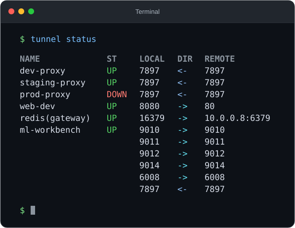

# ssh-tunnel-manager

A lightweight, configuration-driven SSH tunnel manager for macOS and Linux. Manage multiple local and remote port forwards from a single terminal without extra runtime libraries or keeping terminal windows open.

`tunnel` is a Bash script built on OpenSSH's native control socket mechanism. Define your tunnels once in `~/.ssh/tunnels.toml`, then connect, disconnect, restart, or inspect them by name.

```sh
tunnel connect proxy db
tunnel status
tunnel disconnect all
```

## Features

- **No extra runtime libraries** — uses Bash 3.2+, AWK, OpenSSH, and standard Unix utilities available on macOS and most Linux distributions.
- **Local and remote forwarding** — supports both `ssh -L` and `ssh -R`.
- **Multiple forwards per connection** — group any number of local and remote forwarding rules under one named SSH connection.
- **Color-coded status** — compact, color-coded tables with automatically sized columns and explicit forwarding arrows and plain text available for redirected output.
- **Cross-host forwarding** — reach services on other hosts accessible from either end of the SSH connection.
- **Background connections** — no dedicated terminal windows required.
- **Named tunnels** — manage each tunnel independently, including multiple tunnels through the same SSH server.
- **Batch operations** — connect, disconnect, or restart multiple tunnels with a single command.
- **Native connection control** — uses OpenSSH control sockets rather than process-name matching or manual PID management.
- **Configuration validation** — detects invalid settings, duplicate names, and malformed endpoints before performing operations.
- **Connection safeguards** — SSH keepalives, forwarding failure detection, per-tunnel operation locks, and conservative stale socket cleanup.
- Supports IPv4, bracketed IPv6 addresses, and hostnames.

## Requirements

- macOS or Linux (including Ubuntu and Debian).
- Bash 3.2 or newer. The script is not a POSIX `sh` script; do not invoke it with `sh tunnel`.
- OpenSSH client with control socket support, AWK, and standard Unix utilities (`cat`, `mkdir`, `chmod`, `rm`, `rmdir`, `sleep` with fractional seconds, and `wc`).
- An accessible SSH server that permits the required TCP forwarding direction, with authentication configured. Key-based authentication is recommended.

Commands are resolved through `PATH`; the script avoids GNU-only options and AWK-specific dynamic-width printf extensions. Missing dependencies are reported before tunnel operations. macOS normally ships with the required tools. On minimal Linux installations, install any missing packages using your distribution's package manager:

```sh
# Ubuntu / Debian
sudo apt install bash openssh-client mawk coreutils

# Fedora / Rocky Linux / AlmaLinux
sudo dnf install bash openssh-clients gawk coreutils

# Alpine Linux
sudo apk add bash openssh-client gawk coreutils
```

Alpine and other minimal distributions may require additional setup; they are not specifically integration-tested. WSL can also use Linux-compatible dependencies, but `local` refers to the Linux SSH client's network environment, not necessarily the Windows host. No Python, Node.js, jq, autossh, Homebrew, or other runtime framework is needed.

## Installation

Clone or download this repository, then run the following commands from its root directory:

```sh
mkdir -p "$HOME/.local/bin" "$HOME/.ssh/tunnels"
chmod 700 "$HOME/.ssh/tunnels"

install -m 755 tunnel "$HOME/.local/bin/tunnel"

# Install the example configuration without overwriting an existing one.
if [ ! -e "$HOME/.ssh/tunnels.toml" ]; then
    install -m 600 tunnels.toml "$HOME/.ssh/tunnels.toml"
fi
```

Add the following line to your shell startup file (`~/.zshrc` for Zsh, `~/.bashrc` for interactive Bash, or the appropriate login profile) if `~/.local/bin` is not already on your `PATH`:

```sh
export PATH="$HOME/.local/bin:$PATH"
```

Open a new terminal, or run the same `export` command in your current shell, and verify the installation:

```sh
tunnel --version
tunnel --help
```

### Updating

Replace the installed script with `install -m 755 tunnel "$HOME/.local/bin/tunnel"`. Version 1.3.0 preserves the existing configuration and control socket paths. Upgrading the script does not require restarting active tunnels.

## Configuration

Replace the sample SSH hosts and endpoints in `~/.ssh/tunnels.toml` with your own values. Each `[tunnels.NAME]` table defines one independent tunnel.

```toml
[tunnels.proxy]
host = "gpu-server"
type = "remote"
local = "127.0.0.1:7897"
remote = "127.0.0.1:7897"

[tunnels.db]
host = "gateway"
type = "local"
local = "127.0.0.1:13306"
remote = "127.0.0.1:3306"

[tunnels.redis]
host = "gateway"
type = "local"
local = "127.0.0.1:16379"
remote = "10.0.0.20:6379"
```

| Field | Required | Description |
| --- | --- | --- |
| `host` | Yes | SSH host alias, hostname, or `user@host`. |
| `type` | Yes | `local` for local forwarding (`-L`), or `remote` for remote forwarding (`-R`). |
| `local` | Yes | Endpoint on the SSH client side (`host:port`). |
| `remote` | Yes | Endpoint on the SSH server side (`host:port`). |

The meaning of `local` and `remote` is consistent regardless of forwarding direction:

| Type | Listening endpoint | Destination endpoint |
| --- | --- | --- |
| `local` | `local` | `remote` |
| `remote` | `remote` | `local` |

For IPv6 endpoints, use brackets, for example `[::1]:8080`.

### Multiple forwards in one connection

Use TOML arrays of tables (`[[tunnels.NAME.forwards]]`) to group several port forwards under the same SSH master. The parent `type` is the default direction for its rules. Each rule can override it.

```toml
[tunnels.gpu]
host = "gpu-server"
type = "local"

[[tunnels.gpu.forwards]]
local = "127.0.0.1:9010"
remote = "127.0.0.1:9010"

[[tunnels.gpu.forwards]]
local = "127.0.0.1:9011"
remote = "127.0.0.1:9011"

[[tunnels.gpu.forwards]]
type = "remote"
local = "127.0.0.1:7897"
remote = "127.0.0.1:7897"
```

```sh
tunnel connect gpu
tunnel status gpu
tunnel disconnect gpu
```

This creates one SSH connection with two `-L` arguments and one `-R` argument. All rules share the same lifecycle and control socket. `ExitOnForwardFailure=yes` requests that OpenSSH fail startup if a requested listener cannot be established; it does not check the destination application.

In grouped mode, `host` belongs in the parent, `type` is optional in the parent if every rule specifies its own direction, and each forward requires `local` and `remote`. Do not mix parent-level `local`/`remote` keys with `forwards` tables. Existing single-forward configurations remain valid without changes.

### SSH configuration

SSH connection settings remain in `~/.ssh/config`. This allows existing aliases, custom ports, identity files, jump hosts, and other compatible SSH options to be reused without duplicating connection settings in `tunnels.toml`.

```sshconfig
Host gpu-server
    HostName gpu.example.com
    User developer
    IdentityFile ~/.ssh/id_ed25519

Host gateway
    HostName gateway.example.com
    User developer
    Port 22
    IdentityFile ~/.ssh/id_ed25519
```

Replace these example values with your actual SSH settings. Verify that `ssh gateway` works before creating a tunnel through it.

Avoid adding `LocalForward` or `RemoteForward` to SSH host entries used by `tunnel`, because OpenSSH may establish those additional forwards as well.

### Supported TOML syntax

To remain dependency-free, `tunnel` implements a deliberately limited TOML parser, not a complete TOML implementation.

- Tables must use `[tunnels.NAME]` syntax.
- Tunnel names may contain ASCII letters, digits, underscores, and hyphens (up to 40 characters). The name `all` is reserved.
- A legacy table contains `host`, `type`, `local`, and `remote`. A grouped table contains `host`, an optional default `type`, and one or more immediately following `[[tunnels.NAME.forwards]]` tables with `local`, `remote`, and an optional `type`. All values are single-line, double-quoted strings.
- Duplicate listening endpoints within the same direction and tunnel are rejected. Other bind conflicts are detected by OpenSSH.
- Blank lines, full-line comments, and trailing comments are supported.
- String escapes, multiline strings, ordinary arrays, and arbitrary TOML settings are not supported. Only the documented `forwards` array-of-tables syntax is supported.
- Ports must be decimal integers from 1 to 65535 without leading zeros.

## Usage

```text
tunnel [list|status|connect|disconnect|restart|help] [NAME ...|all]
```

| Command | Description |
| --- | --- |
| `tunnel` | Show the status of all configured tunnels. |
| `tunnel list` | List configured tunnels, forwarding rules, and connection status. |
| `tunnel status` | Show the status of all configured tunnels. |
| `tunnel status proxy` | Show the status of a specific tunnel. |
| `tunnel connect proxy` | Establish a named tunnel. |
| `tunnel connect proxy db` | Establish multiple named tunnels. |
| `tunnel connect all` | Establish all configured tunnels. |
| `tunnel disconnect proxy` | Close a named tunnel. |
| `tunnel disconnect all` | Close all configured tunnels. |
| `tunnel restart db` | Disconnect and reconnect a named tunnel. |
| `tunnel restart all` | Restart all configured tunnels. |
| `tunnel help` | Display usage information. |
| `tunnel --version` | Print the installed version. |

`start` and `stop` are aliases for `connect` and `disconnect`, respectively. Commands that change connection state require explicit tunnel names or the keyword `all`.

### Example output

```text
$ tunnel status
NAME               ST    LOCAL  DIR  REMOTE
proxy(gpu-server)  UP    7897   <-   7897
gpu(gpu-server)    UP    9010   ->   9010
                         9011   ->   9011
db(gateway)        DOWN  13306  ->   3306
```

| ST | Color | Meaning |
| --- | --- | --- |
| `UP` | Green | The SSH master responds to a control socket check. |
| `DOWN` | Red | No control socket exists for the tunnel. |
| `STALE` | Yellow | A socket exists, but the connection to it was refused. |
| `?` | Magenta | The control socket state could not be safely determined. |

Both `list` and `status` use an aligned table, check the SSH master once per tunnel, and show its name and state only on the first forwarding row. Each column has an independent fixed width for the current output, calculated from its header and the selected rows. Columns are separated by two spaces; ANSI color codes do not affect alignment. The `NAME` column shows just `name` when the tunnel name already contains the complete configured SSH host as a literal, case-sensitive substring (including an exact match). For example, `gpu-server-proxy` with host `gpu-server` is shown as `gpu-server-proxy`. Otherwise it shows `name(host)`, such as `db(gateway)`. There is no separate host column. Use the original tunnel name, without the parenthesized host, in commands.

- `LOCAL` and `REMOTE` are the client-side and server-side endpoints, respectively, regardless of forwarding direction.
- A bare port (such as `9010`) means exactly `127.0.0.1:9010` on that side. All other addresses, including IPv6, wildcard binds, and hostnames, remain explicit.
- `->` (cyan) indicates local forwarding (`-L`); `<-` (blue) indicates remote forwarding (`-R`). Arrows point from the listening endpoint to the destination, not the direction of individual TCP packets (TCP is bidirectional).
- Widths are calculated only from the tunnels included in the current command. Long hostnames or addresses are never truncated; on a narrow terminal, such rows may still wrap naturally.

The compact table does not change any configuration values or SSH arguments.

Colors are enabled by default on interactive terminals and disabled for redirected output, `TERM=dumb`, or a non-empty `NO_COLOR` variable. Override the default with:

```sh
TUNNEL_COLOR=always tunnel status
TUNNEL_COLOR=never tunnel list
NO_COLOR=1 tunnel status
```

`TUNNEL_COLOR=always` explicitly forces color even in pipelines; `TUNNEL_COLOR=never` always disables it.

`UP` indicates the SSH master is responding; it does not guarantee that the destination service is reachable or healthy. Test the forwarded application separately.

## Forwarding examples

In the diagrams below, `local` means the SSH client side (your local machine), while `remote` means the SSH server side.

### 1. Access a remote service from your local machine

Forward a local port to a MySQL service running on the SSH server:

```toml
[tunnels.db]
host = "gateway"
type = "local"
local = "127.0.0.1:13306"
remote = "127.0.0.1:3306"
```

```text
Client :13306  ---- SSH tunnel ---->  Gateway (MySQL :3306)
```

Equivalent SSH forwarding command:

```sh
ssh -N -L 127.0.0.1:13306:127.0.0.1:3306 gateway
```

Run `tunnel connect db`, then configure your database client to connect to `127.0.0.1:13306`.

### 2. Expose a local proxy to a remote server

Allow a remote server to access an HTTP proxy running on your local machine:

```toml
[tunnels.proxy]
host = "gpu-server"
type = "remote"
local = "127.0.0.1:7897"
remote = "127.0.0.1:7897"
```

```text
Client (proxy :7897)  <---- SSH tunnel ----  GPU server :7897
```

Equivalent SSH forwarding command:

```sh
ssh -N -R 127.0.0.1:7897:127.0.0.1:7897 gpu-server
```

Run `tunnel connect proxy` on your local machine. On the remote server, if your local proxy supports HTTP proxy connections:

```sh
export http_proxy=http://127.0.0.1:7897
export https_proxy=http://127.0.0.1:7897

curl -I https://example.com
```

Multiple independent SSH servers can use the same proxy running on your local machine without conflicting with one another.

### 3. Access a service on another remote host

Use an SSH server as a gateway to a private network. The destination does not need to be the SSH server itself.

```toml
[tunnels.redis]
host = "gateway"
type = "local"
local = "127.0.0.1:16379"
remote = "10.0.0.20:6379"
```

```text
Client :16379  ---- SSH tunnel ---->  Gateway  ---- TCP ---->  Redis host :6379
```

Equivalent SSH forwarding command:

```sh
ssh -N -L 127.0.0.1:16379:10.0.0.20:6379 gateway
```

Run `tunnel connect redis` and connect your Redis client to `127.0.0.1:16379`. The gateway must be able to reach `10.0.0.20:6379`.

Internal DNS names, such as `redis.internal.example:6379`, also work if they can be resolved by the SSH server. No SSH service is required on the final destination host.

### 4. Forward from a remote server to a local network device

Remote forwarding also supports destinations accessible from the SSH client's local network:

```toml
[tunnels.lan-proxy]
host = "gpu-server"
type = "remote"
local = "192.168.1.100:7897"
remote = "127.0.0.1:7897"
```

```text
LAN proxy :7897  <---- TCP ----  Client  <---- SSH tunnel ----  GPU server :7897
```

Equivalent SSH forwarding command:

```sh
ssh -N -R 127.0.0.1:7897:192.168.1.100:7897 gpu-server
```

Run `tunnel connect lan-proxy`. Your local machine must be able to reach the LAN proxy.

For local forwarding, destination hostnames are resolved on the SSH server side. For remote forwarding, destination hostnames are resolved on the SSH client side.

## How it works

Each named tunnel (regardless of how many forwarding rules it contains) runs its own background OpenSSH master connection using a dedicated Unix-domain control socket:

```text
~/.ssh/
├── config
├── tunnels.toml
└── tunnels/
    ├── proxy.sock
    ├── db.sock
    └── redis.sock
```

The script starts connections with `ssh -f -N -T -M`, checks them with `ssh -O check`, and closes them with `ssh -O exit`. This keeps tunnel management separate from ordinary interactive SSH sessions that use other control paths.

The following connection options are set by the script:

| Option | Value |
| --- | --- |
| `ControlPersist` | `no` |
| `ExitOnForwardFailure` | `yes` |
| `ServerAliveInterval` | `30` |
| `ServerAliveCountMax` | `3` |
| `ConnectTimeout` | `10` |
| `PermitLocalCommand` | `no` |
| `ForwardAgent` | `no` |
| `ForwardX11` | `no` |

Closing a terminal window does not normally stop an established tunnel. The tool does not currently implement automatic reconnection, login-time startup, or continuous health monitoring.

## Security considerations

- Bind listening endpoints to `127.0.0.1` or `[::1]` unless other machines explicitly need access. A wildcard or non-loopback bind can expose your forwarded service to other users or devices.
- Remote forwarding is also subject to the SSH server's `GatewayPorts` setting; depending on server configuration, the effective listening address may differ from the requested one.
- The SSH server must permit the relevant forwarding direction (`AllowTcpForwarding`), and may restrict destinations or listening ports through `PermitOpen`, `PermitListen`, or key-specific restrictions.
- SSH encrypts traffic between the SSH client and SSH server. Traffic from either SSH endpoint to a separate destination host is not automatically encrypted by SSH; use application-level TLS where needed.
- Store SSH credentials in your normal SSH configuration and key files, not in `tunnels.toml`.
- SSH host-key verification is handled by OpenSSH. Do not disable it merely to avoid connection prompts.

## Troubleshooting

| Problem | What to check |
| --- | --- |
| Missing dependency | Install the named executable and ensure it is on `PATH`. |
| Connection fails | Verify the SSH alias and authentication with `ssh HOST`. Check forwarding permissions and port availability. |
| Address already in use | Another service or tunnel may already occupy the listening port on the relevant machine. Choose a different port or stop the conflicting process. |
| Connected, but service unavailable | Verify the destination address, DNS resolution, service binding, and firewall from the forwarding side. Test the application through the tunnel. |
| Tunnel stops after sleep or network changes | Run `tunnel connect NAME` or `tunnel restart NAME`. Automatic reconnection is not implemented. |
| Configuration changes have no effect | Run `tunnel restart NAME` after editing the configuration. |
| Stale control socket | Retry `tunnel connect NAME` or `tunnel disconnect NAME`. The script removes sockets only when it detects a refused control connection and the path is a socket, not a symlink. |
| Tunnel reports `busy` | An operation may already be in progress. If the process was forcibly killed, a `.sock.lock` directory may remain. Remove it with `rmdir` only after confirming no operation is running. |
| Control socket path too long | Use a shorter tunnel name. The script conservatively limits the full socket path to 85 bytes to accommodate Unix-domain socket path limits. |

Disconnect a tunnel before removing or renaming its configuration entry. The CLI operates on currently configured names, and deleting an entry does not terminate its running SSH process.

## Exit codes

| Code | Meaning |
| --- | --- |
| `0` | The requested operation completed successfully. Status queries may still report disconnected or stale tunnels. |
| `1` | One or more tunnel operations failed, or a required runtime dependency is missing. |
| `2` | Invalid command, configuration, or requested tunnel name. |

All forwarding rules in a named tunnel are started and stopped together. Batch operations across distinct named tunnels are processed sequentially and continue if an individual operation fails. They are not atomic; successful connections are not rolled back when another connection fails.

## Contributing

Bug reports, feature requests, and pull requests are welcome. When reporting issues, include your operating system and version, `bash --version`, relevant `ssh -V` output, and a minimal configuration example with sensitive values removed.

Keep changes compatible with Bash 3.2 (including the system Bash on macOS) and avoid adding extra runtime dependencies. Do not assume GNU-specific command options or hardcode binary paths. Run the shell syntax check and portable smoke tests:

```sh
bash -n tunnel
bash tests/smoke.sh
```

The smoke tests use a mock SSH executable and isolated home directory to check configuration, command arguments, state transitions and output without remote credentials. The included GitHub Actions workflow is configured to run these tests on macOS (including system Bash) and Ubuntu. They are not a substitute for live end-to-end SSH forwarding tests against a real server.

## License

See the repository's `LICENSE` file for licensing terms once one has been added.
